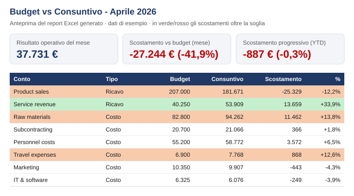

# Budget vs Actual – automated variance report

Turns a monthly budget and the posted G/L entries from an ERP (Microsoft Dynamics 365 Business Central layout) into a formatted Excel variance report, in seconds instead of an afternoon of copy-paste.

> All data in this repository is **synthetic**. The fiscal year runs November → October.

📘 **[Guida in italiano: come replicarlo da un cliente](COME_REPLICARE.md)**

## The result



What the reader gets, in three numbers (sample data, April 2026):

| Operating result | Month vs budget | Year to date vs budget |
|---:|---:|---:|
| **€ 37,731** | **− € 27,244** (−41.9%) | **− € 887** (−0.3%) |

…and, highlighted, the four accounts that explain the gap: product sales below budget, raw materials and travel above it, service revenue well above it.

## What it does

1. Reads the **budget** (period × G/L account × cost center) and the **G/L entries** export.
2. Normalises signs (Business Central posts revenue as negative amounts).
3. Computes **month** and **year-to-date** variances, absolute and %.
4. Classifies each variance as **favourable / unfavourable** (more revenue or less cost than budget = favourable).
5. Writes an Excel report with:
   - **Summary** – operating result (month and YTD) plus the account-level detail
   - **By cost center** – YTD variances by cost center and account
   - **Monthly trend** – revenue and costs, month by month
   - **Top deviations** – the 10 largest gaps to look at first
   
   Rows above the threshold are highlighted in green (favourable) or red (unfavourable).

## Quick start

```bash
pip install -r requirements.txt
python generate_sample_data.py          # creates data/budget.csv and data/actuals.csv
python variance_report.py               # latest month
python variance_report.py --month 2026-06 --threshold 0.15
```

The report is saved in `output/variance_report_<month>.xlsx`.

## Runs by itself

The GitHub Action in `.github/workflows/monthly-report.yml` rebuilds the report on the **5th of every month** (after month-end close) and attaches the Excel file to the run. It can also be started manually from the **Actions** tab, choosing the month.

## Using it with real data

Put the ERP exports in `data/` as they come out of the system:

| File | Business Central page | Columns used |
|---|---|---|
| `actuals.xlsx` / `.csv` | General Ledger Entries | Posting Date, G/L Account No., Amount, Global Dimension 1 Code (optional) |
| `budget.xlsx` / `.csv` | G/L Budget Entries | Date, G/L Account No., Amount, Global Dimension 1 Code (optional) |
| `accounts.xlsx` / `.csv` *(optional)* | Chart of Accounts | No., Name |

- Excel or CSV, comma or semicolon separated, amounts as `1234.56` or `1.234,56`
- Column names in English or Italian (e.g. *Data di registrazione*, *Nr. conto C/G*, *Importo*)
- Revenue vs cost is inferred from the sign, as in Business Central (credit = revenue)

Step-by-step instructions, data requests and the checks to run before delivering are in the **[Italian guide](COME_REPLICARE.md)**.

## Possible extensions

- Read directly from the Business Central API instead of CSV files
- Email the report to cost-center owners
- Add a short AI-written commentary on the main variances
- Publish the same tables to a Power BI dataset

---

🇮🇹 **In breve:** script Python che confronta budget e consuntivo (movimenti contabili in formato Business Central), calcola gli scostamenti del mese e progressivi per conto e centro di costo e produce un report Excel formattato. Con GitHub Actions il report si rigenera da solo ogni mese. Dati di esempio fittizi.

**Author:** [Daniele Marsico](https://github.com/daniele-marsico) · [ControllingHub](https://controllinghub.netlify.app)
